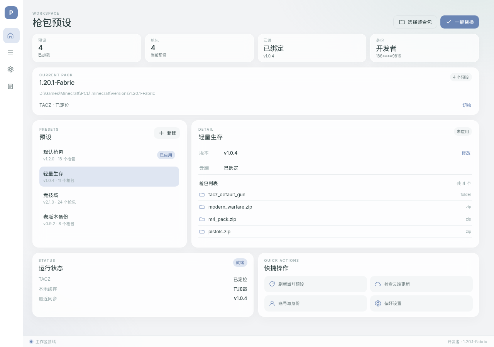

# Pulses Swap 3.0

TACZ 枪包一键切换工具 · **PyWebView + React** 版 · v3.0.2

Pulses Swap 把 Minecraft 的 TACZ 枪包按「预设」分组：拖入整合包、选择预设、
一键替换，也可以把预设发布到蓝奏云，让玩家增量同步。

3.0 是独立分支：UI 从 customtkinter 迁移到 PyWebView + React/Vite；
`pulses/managers.py`、`online/` 等核心业务与原版保持同一套实现。

## 技术结构

```text
src/pulses_web/          PyWebView 应用层
  main.py                窗口 / 本地资源 / DOM 拖拽
  api.py                 js_api 的 invoke 白名单
  controller.py          无 UI 的 AppController
  events.py              JobRunner / EventBus / EventPump
  web/                   React + Vite 前端
    src/App.jsx
    src/bridge.js
    src/styles.css
    package.json

src/pulses/              原有核心：settings / PresetManager / watcher
online/                  原有核心：账号 / 云盘 / 校验 / 同步 / 发布
src/pulses_swap.py       2.x customtkinter 兼容入口（回滚用）
```

所有耗时操作在 `JobRunner` 的后台线程执行；`EventPump` 把进度和结果推给前端。
`js_api` 方法运行在独立线程，因此修改型任务串行执行，避免并发改同一个数据库/目录。

## 开发

需要 Python 3.11+、Node 22、Windows 10/11 + WebView2 Runtime。

```bash
python -m pip install -r requirements-web.txt

cd src/pulses_web/web
npm ci --include=dev
npm run build

cd ../../..
python -m pulses_web.main
```

开发前端时可启动 Vite：

```bash
cd src/pulses_web/web
npm run dev
# 另开终端，指定开发地址
PULSES_WEB_DEV=http://127.0.0.1:5173 python -m pulses_web.main
```

生产版必须先把 `web/dist` 构建出来；PyWebView 通过本地 HTTP server 加载静态资源。

## 功能

- 整合包选择/拖入、TACZ 自动定位、最近整合包。
- 预设创建/重命名/删除/版本、枪包列表、一键替换与进度。
- TACZ 文件变化监视。
- 蓝奏云账号、绑定分享、检查差异、增量同步、完全同步、取消。
- 开发者发布计划/发布/历史。
- 设置、数据库目录、日志、身份切换。
- 页面/身份切换的完整 `Pulses Swap` 长字标幕布。
- 原生标题栏、最小窗口 1140×812、严格还原原版的信息架构和色值。

## 打包

前端构建后使用：

```bash
pyinstaller packaging/pulses_web.spec --noconfirm --clean
```

Windows 安装器需要有 WebView2 Runtime；`packaging/installer.iss` 会在缺失时
运行随包的 Evergreen Bootstrapper。绿色版用户需要系统已安装 WebView2。

CI 见 `.github/workflows/build-web.yml`。

## 测试

```bash
PYTHONPATH=src python -m unittest discover -s tests -q
cd src/pulses_web/web && node test-ui.mjs
```

## 截图



更多截图在 `docs/web-ui/`。
